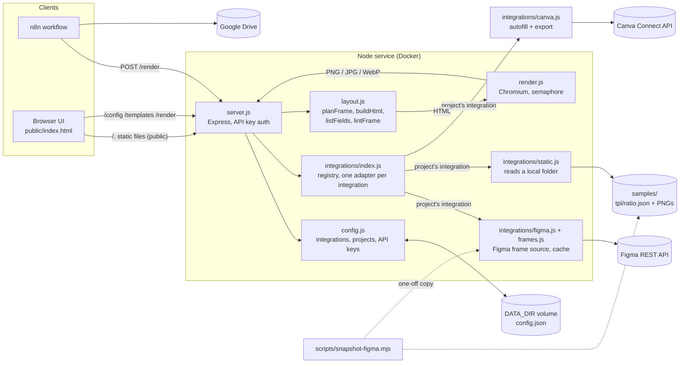
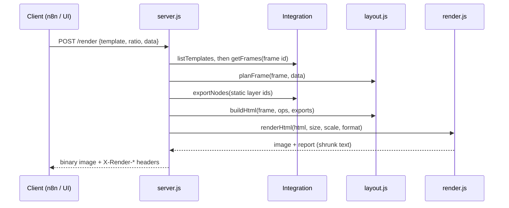

# Architecture

## Render request

## Integration interface

`parseSource`, `check`, `listTemplates`, `render`, optional `html` for live preview, `clearCache` (see `src/integrations/index.js`).
A request's project decides the integration; with no project given, the default project is used.
